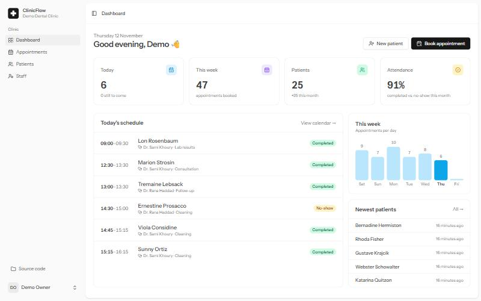
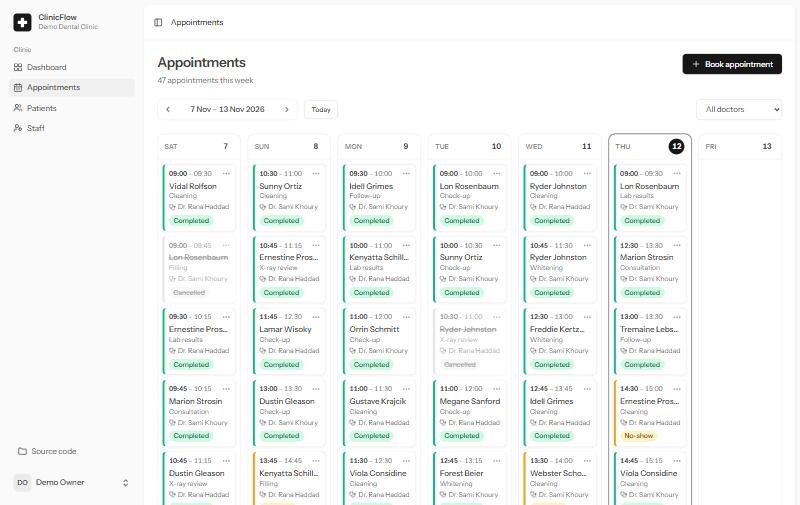
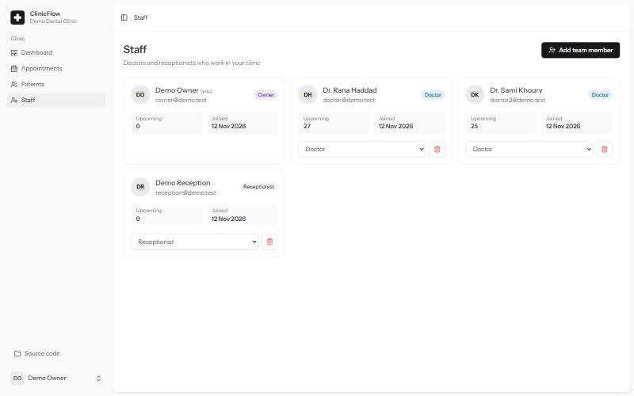

<div align="center">

# ClinicFlow

**Multi-tenant clinic management SaaS: patients, appointments and staff in one place.**

[](https://github.com/deema-khaled/clinicflow/actions/workflows/tests.yml)
[](https://github.com/deema-khaled/clinicflow/actions/workflows/lint.yml)




</div>

## What it does

Each clinic signs up and gets its own private workspace. Its team (owner, doctors, receptionists) manages patients and books appointments on a weekly calendar. A doctor can never be double-booked, and every role sees only what it should.

| Weekly calendar | Team management |
| --- | --- |
|  |  |

## Features

- **Multi-tenancy (single database).** Every clinic's data is isolated automatically by a global Eloquent scope. A record from another clinic returns `404`, as if it didn't exist.
- **No double-booking.** Overlapping appointments for the same doctor are rejected at validation time, with a message naming the clash. Cancelled slots free up, and restoring a cancelled appointment re-checks the slot.
- **Weekly calendar.** Navigate by week, filter by doctor, and complete, cancel or mark no-show from a quick menu.
- **Role-based access.** Policies and gates for **Owner / Doctor / Receptionist**. Medical notes are never sent to a receptionist's browser, not just hidden in the UI.
- **Patients.** Server-side search (case-insensitive on PostgreSQL), pagination, phone numbers unique *per clinic*, soft deletes.
- **Dashboard.** Today's schedule, appointments per day, attendance rate, newest patients.
- **Team management.** Owners add doctors and receptionists, change roles, and remove members.
- **Onboarding.** Registering creates the clinic and makes you its owner, in one transaction.

## Tech stack

| Layer | Tools |
| --- | --- |
| Backend | Laravel 12, PHP 8.2+, Eloquent, Form Requests, Policies |
| Frontend | Vue 3 (Composition API) + TypeScript, Inertia.js 2, Tailwind CSS, shadcn-vue |
| Data | PostgreSQL 17, Redis 7 (cache, sessions, queues) |
| Quality | Pest (87 tests, ~390 assertions), Laravel Pint, ESLint, Prettier |
| DevOps | Docker (multi-stage: PHP-FPM + Nginx), GitHub Actions (tests on SQLite **and** PostgreSQL) |

## How tenancy works

```php
// app/Models/Concerns/BelongsToClinic.php
trait BelongsToClinic
{
    public static function bootBelongsToClinic(): void
    {
        static::addGlobalScope(new ClinicScope);   // reads: WHERE clinic_id = <your clinic>

        static::creating(function ($model) {       // writes: always your clinic
            if (Auth::hasUser()) {
                $model->clinic_id = Auth::user()->clinic_id;
            }
        });
    }
}
```

`clinic_id` is deliberately **not** mass-assignable. Even if a request sends another clinic's id, the record is still saved to the signed-in user's clinic. Tests cover this.

## Quick start

### Option A: everything in Docker

```bash
git clone https://github.com/deema-khaled/clinicflow.git
cd clinicflow
cp .env.example .env
# Generate a key and paste it into APP_KEY in .env
docker run --rm -v "$PWD":/app -w /app php:8.4-cli php -r "echo 'base64:'.base64_encode(random_bytes(32)).PHP_EOL;"
docker compose --profile app up -d --build
```

Open **http://localhost:8000**. Demo data is seeded on first start.

### Option B: local development

Requires PHP 8.2+, Composer and Node 20+. PostgreSQL and Redis run in Docker.

```bash
composer install && npm install
cp .env.example .env && php artisan key:generate
docker compose up -d              # PostgreSQL on :5433, Redis on :6379
php artisan migrate --seed
composer run dev                  # app on http://localhost:8080 with Vite hot reload
```

### Demo accounts

All passwords are `password`.

| Email | Role | Clinic |
| --- | --- | --- |
| `owner@demo.test` | Owner | Demo Dental Clinic |
| `doctor@demo.test` | Doctor | Demo Dental Clinic |
| `reception@demo.test` | Receptionist | Demo Dental Clinic |
| `owner@other.test` | Owner | Other Family Clinic (to see the isolation) |

## Tests

```bash
php artisan test
```

The suite covers tenant isolation, double-booking edge cases (same slot, partial overlap, surrounding, back-to-back), role permissions, validation, and the dashboard numbers. CI runs it against both SQLite and PostgreSQL.

## Project structure

```
app/
├── Enums/                 Role, AppointmentStatus
├── Http/Controllers/      Dashboard, Patient, Appointment, Staff
├── Http/Requests/         PatientRequest, AppointmentRequest (overlap check)
├── Models/Concerns/       BelongsToClinic (tenancy)
├── Models/Scopes/         ClinicScope
└── Policies/              PatientPolicy, AppointmentPolicy
resources/js/
├── pages/                 Dashboard, appointments/, patients/, staff/
└── components/            AppointmentForm, PatientForm, StatusBadge, …
docker/                    Dockerfile, nginx.conf, php.ini, entrypoint.sh
```

## License

MIT
